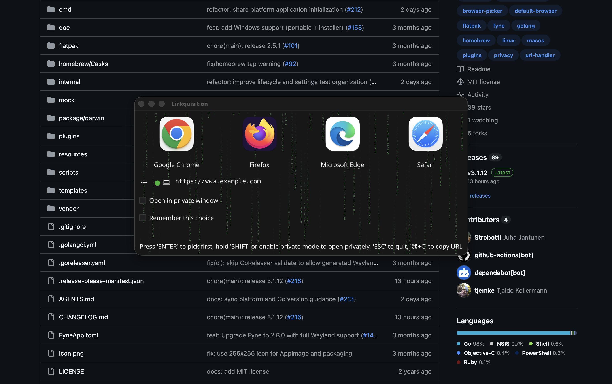
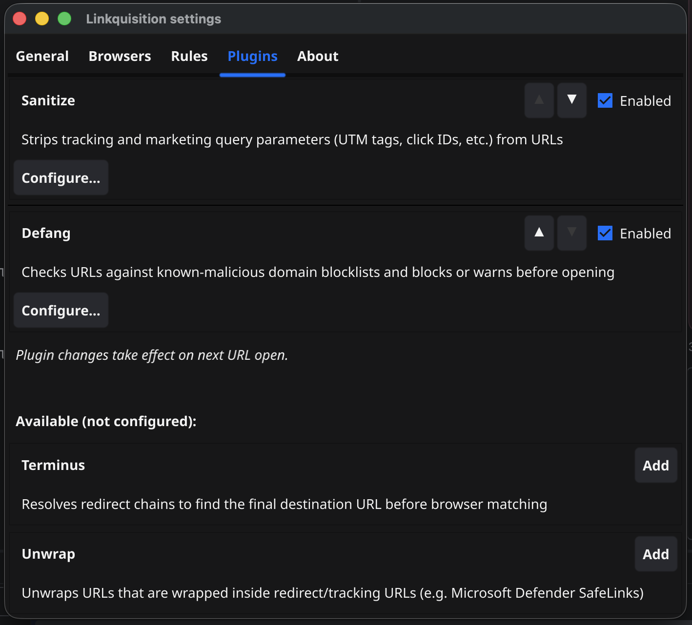

# Linkquisition

[](https://go.dev/)
[](LICENSE)
[](https://github.com/Strobotti/linkquisition/releases/latest)
[](https://github.com/Strobotti/linkquisition)
[](https://github.com/strobotti/homebrew-tap)

Linkquisition is a fast, configurable browser-picker for Linux, macOS, and Windows written in Go.

...as nobody expects the Linkquisition!



## What is it?

Motivation behind this project is:

1. I needed a fast browser-picker for Linux desktop that is configurable to automatically choose a browser based on
   different rules
2. I have written a lot of server-side code in Go and wanted to see how easy it is to write a desktop app in Go

## Features

- Fast
- Configurable
    - Automatically chooses a browser based on different rules
        - domain (e.g. `example.com`)
        - site (e.g. `www.example.com`)
        - regular expression (e.g. `.*\.example\.com`)
    - Hide a browser from the list
    - Detect Chromium-family and Firefox profiles and choose a profile directly in the picker
    - Open a browser profile in a private window with the picker toggle or by holding `Shift`
    - Manually add a browser to the list (for example, to open a URL in a different profile)
    - Rename any browser in the configuration screen; the name is kept when re-scanning
    - Remember the choice for a given site
- keyboard-shortcuts
    - `Enter` to open the URL in the default browser
    - `Ctrl+C` to just copy the URL to clipboard and close the window
    - Number keys (1-9) to select a browser
    - `Shift` (held) to open the selected browser in a private window
- Optional favicon display next to the URL in the picker (lazy-loaded, no startup delay)
    - Three retrieval strategies: direct (`/favicon.ico`), parsed (HTML link tag), or Google's service
- URL safety checking via [Google Safe Browsing](https://safebrowsing.google.com/) or
  [VirusTotal](https://www.virustotal.com/) — shows a color-coded indicator in the picker with a clickable link to the
  full provider report
- WHOIS lookup — view domain registration details (registrar, age, expiry, DNSSEC status)
  directly from the picker's context menu
- QR code generation — generate a scannable QR code for the URL to quickly open it on a mobile device
- Manual update check in the About tab — see if a newer release is available on GitHub

## Installation

### Linux

You can download the latest `.deb` package or portable AppImage from
the [releases page](https://github.com/Strobotti/linkquisition/releases).

#### .deb package (Ubuntu/Debian)

The `.deb` package contains everything needed to launch the application using the desktop-environment, e.g. you should
be able to press `Super`-key in Ubuntu and type "Linkquisition" to see the launcher. To do the same in terminal just run
`linkquisition` command. Launching the application without any arguments will show the configuration screen which allows
you to set it as the default browser and scan for installed browsers for faster startup and easier configuration.

#### AppImage (any distribution)

The AppImage is a single portable file that works on any Linux distribution without installation:

```bash
chmod +x Linkquisition-*-x86_64.AppImage
./Linkquisition-*-x86_64.AppImage
```

### macOS

#### Via Homebrew (recommended)

```bash
brew tap strobotti/tap
brew install --cask linkquisition
```

Since the app is not notarized with Apple, macOS will block it on first launch. To fix this, run:

```bash
xattr -cr /Applications/Linkquisition.app
```

#### Manual installation

Download the latest `Linkquisition_macOS_universal.zip` from
the [releases page](https://github.com/Strobotti/linkquisition/releases), unzip it, and move
`Linkquisition.app` to `/Applications`.

The universal binary supports both Apple Silicon (arm64) and Intel (amd64) Macs.

Since the app is not notarized with Apple, macOS will block it on first launch. To fix this, run:

```bash
xattr -cr /Applications/Linkquisition.app
```

### Windows

Download the latest `Linkquisition_Windows_amd64.zip` (portable) or
`Linkquisition-*-setup.exe` (installer) from the [releases page](https://github.com/Strobotti/linkquisition/releases).

#### Installer

The installer registers Linkquisition as a URL handler and creates Start Menu shortcuts. After installation, open
Windows Settings → Default Apps to select Linkquisition as your default browser.

Since the app is not code-signed, Windows SmartScreen may show a warning on first launch. Click "More info" → "Run
anyway" to proceed.

#### Portable

Extract `linkquisition.exe` from the .zip and run it directly. To register as the default browser, run
`linkquisition set-default` from the directory containing the executable.

**Note:** Plugins are not supported on Windows. The plugin tab and plugin-related CLI commands are not available on this
platform.

**OpenGL fallback:** The release includes Mesa3D's software OpenGL renderer (`opengl32.dll`) for systems without a
hardware GPU driver (virtual machines, RDP sessions, basic display adapters). If your system has a proper GPU driver,
you can safely delete `opengl32.dll` — the app will use the hardware driver instead.

## Configuration



As mentioned in the installation section, you can launch the application without any arguments to show the configuration
screen.

To set Linkquisition as the default browser, you can click the "Set as default" button and after this any links opened
(outside browsers) will either show you the screen to choose a browser, or open one automatically if configured so.

The configuration file is located at `~/.config/linkquisition/config.json` and clicking the "Scan browsers" button will
create one if it does not exist, or update it with the currently installed browsers. Re-scanning later will not remove
any manually added browsers or rules to existing browsers.

If adding a browser-entry manually to the config.json be sure to mark it as "manual" to prevent it from being removed on
next scan. Also, if you want to hide a browser from the list, you can have it's "hidden" -attribute with value
`true`.

Please note that the scan will use the "command" -attribute as the identifier for the browser, so if change the command
it will be treated as a different browser and might be removed if not safe-guarded with `"source": "manual"` -setting.

### An example config.json -file

```json
{
  "locale": "",
  "browsers": [
    {
      "name": "Microsoft Edge",
      "command": "/usr/bin/microsoft-edge-stable %U",
      "iconPath": "/usr/share/icons/hicolor/128x128/apps/microsoft-edge.png",
      "hidden": false,
      "source": "auto",
      "matches": [
        {
          "type": "site",
          "value": "www.office.com"
        }
      ]
    },
    {
      "name": "Firefox",
      "command": "firefox %u",
      "iconPath": "/usr/share/icons/hicolor/128x128/apps/firefox.png",
      "hidden": false,
      "source": "auto",
      "matches": [
        {
          "type": "site",
          "value": "www.facebook.com"
        }
      ]
    }
  ],
  "security": {
    "enabled": true,
    "provider": "google_safe_browsing",
    "apiKey": "YOUR_API_KEY",
    "cache": {
      "enabled": true,
      "ttlHours": 24
    }
  }
}
```

### Localization

Linkquisition supports localization. The UI language is determined in the following order:

1. If `locale` is set in `config.json` (e.g. `"locale": "fi"`), that locale is used
2. Otherwise, the system locale is auto-detected
3. If no matching translation is available, English is used as fallback

Currently supported languages:

- English (en) — default
- Brazilian Portuguese (pt-BR)
- Finnish (fi)
- French (fr)
- German (de)
- Hungarian (hu)
- Portuguese (pt)
- Spanish (es)
- Swedish (sv)
- Ukrainian (uk)

To contribute a new translation, add a JSON file to `internal/i18n/translations/` following the format of the existing
files (e.g. `en.json`). The filename should be the locale code (e.g. `de.json` for German).

### Picker context menu

The browser picker has a context menu (⋯ button) next to the URL with these features:

- **Copy URL** — copy the (possibly plugin-modified) URL to clipboard
- **QR Code** — generates a scannable QR code for the URL, useful for quickly opening it on a mobile device
- **WHOIS** — performs a live WHOIS lookup and shows domain registration details: registrar, creation/expiry dates,
  domain age, DNSSEC status, name servers, and EPP status codes

### URL safety checking

When enabled, the picker shows a color-coded dot next to the URL that indicates its safety status:

- **Green** — no threats detected
- **Yellow** — check failed or URL is suspicious
- **Red** — URL is flagged as malicious

Clicking the dot opens a popup with the provider name, threat level, details, and a link to view the full report on the
provider's website.

To enable safety checking, add a `security` section to your `config.json`:

```json
{
  "security": {
    "enabled": true,
    "provider": "google_safe_browsing",
    "apiKey": "YOUR_API_KEY",
    "cache": {
      "enabled": true,
      "ttlHours": 24
    }
  }
}
```

Supported providers:

| Provider               | How to get an API key                                                                                                                                             |
|------------------------|-------------------------------------------------------------------------------------------------------------------------------------------------------------------|
| `google_safe_browsing` | [Google Cloud Console](https://console.cloud.google.com/apis/credentials) — enable the Safe Browsing API, then create an API key. Free tier: 10,000 requests/day. |
| `virustotal`           | [VirusTotal](https://www.virustotal.com/gui/my-apikey) — sign up for a free account. Free tier: 4 requests/minute, 500/day.                                       |

The check runs asynchronously — it never blocks the picker from appearing. Results are cached locally (when
`cache.enabled` is `true`) to reduce API calls on repeated URLs.

### Favicon

The picker can display the website's favicon next to the URL. Enable it in your config:

```json
{
  "ui": {
    "showFavicon": true,
    "faviconStrategy": "direct"
  }
}
```

Available strategies:

| Strategy           | Description                                                                                                   |
|--------------------|---------------------------------------------------------------------------------------------------------------|
| `direct` (default) | Fetches `/favicon.ico` from the host. Fast and privacy-friendly.                                              |
| `parsed`           | Downloads the page HTML and parses the `<link rel="icon">` tag. More accurate but slower (two HTTP requests). |
| `google`           | Uses Google's favicon service. Reliable but sends the URL to Google.                                          |

Favicons are cached locally for 7 days to avoid repeated network requests.

## Command-line interface

In addition to the GUI, Linkquisition provides a full CLI for scriptable configuration:

```bash
# Show help
linkquisition --help

# Version
linkquisition --version

# Configuration
linkquisition config                        # show full config as JSON
linkquisition config get logLevel           # get a single value
linkquisition config set logLevel debug     # set a value
linkquisition config set ui.theme dark      # set UI theme (system/dark/light)
linkquisition config path                   # print config file path

# Plugin management
linkquisition plugin list                   # list configured + available plugins
linkquisition plugin enable <name>          # enable a plugin
linkquisition plugin disable <name>         # disable a plugin
linkquisition plugin add <name>             # add an available plugin with defaults

# Browser management
linkquisition browsers list                 # list configured browsers
linkquisition browsers scan                 # scan system for installed browsers

# Match rules
linkquisition rule list                     # list all URL match rules
linkquisition rule list firefox             # list rules for a specific browser
linkquisition rule add firefox site github.com        # add a rule
linkquisition rule add chrome regex ".*\.example\.com"  # add a regex rule
linkquisition rule remove firefox 1         # remove rule by index

# Set as default browser
linkquisition set-default

# Test/trace URL processing (dry run)
linkquisition test-url "https://example.com/page?utm_source=twitter"

# Override plugin settings at runtime (not persisted)
linkquisition --plugin-opt shenanigans.effect=matrix "https://example.com"

# Override log level for a single run (not persisted)
linkquisition --log-level debug "https://example.com"

# Disable all plugins (for debugging)
linkquisition --no-plugins "https://example.com"
```

On macOS, the binary is located at `/Applications/Linkquisition.app/Contents/MacOS/linkquisition`. You can create a
symlink for convenience:

```bash
ln -s /Applications/Linkquisition.app/Contents/MacOS/linkquisition /usr/local/bin/linkquisition
```

## Development

I primarily use Ubuntu Linux for development, so the instructions are tailored for that. The code should work on any
Freedesktop.org-compliant Linux distribution, although I have not tested all distributions. CI currently builds Linux
amd64, macOS arm64 (with universal release packaging), and Windows amd64; other targets may work but are not covered by
the build matrix.

### Requirements

- Go 1.27.3 (https://go.dev/doc/install)
- Taskfile (https://taskfile.dev/#/installation)
- Build-dependencies:
  ```shell
  sudo apt-get update && sudo apt-get install -y gcc libgl1-mesa-dev xorg-dev libwayland-dev libxkbcommon-dev scdoc
  ```

### Building locally

The following command will build a binary in the `bin` directory:

```bash
./scripts/generate-wayland-protocols.sh # required once after cloning (Linux only)
task build # results in bin/linkquisition-linux-amd64
```

To run in watch mode:

```bash
task build --watch # results in bin/linkquisition-linux-amd64 (rebuilds on any relevant file change)
```

### Packaging locally

Packaging locally is for testing purposes only, actual packaging should be done in a CI/CD pipeline, which currently is
Github.com Actions.

The following command will build a `.deb` package in the `dist` directory:

```bash
# export VERSION=0.1.0-dev # optional, if not set, defaults to 0.0.0
task package:deb # results in dist/linkquisition_0.0.0_amd64.deb
```

### Browser profiles

Scanning detects the profiles of Chromium-family browsers (Chrome, Chromium, Edge, Brave) and Firefox. Each profile
appears in the picker as its own entry, for example `Google Chrome — Work`, so you can open a link in a specific profile
with a single click or number key.

Detection reads each browser's standard profile data:

| Browser family | Where profiles are read from                                   |
|----------------|----------------------------------------------------------------|
| Chromium-based | `Local State` in the browser's user-data folder (`info_cache`) |
| Firefox        | `profiles.ini` in the Firefox profile folder                   |

Profile entries are stored in `config.json` with their identity (`profileName`, `profilePath`, `profileType`). Rules
(`matches`) are attached to the profile they were created for. If a browser was configured before profile support was
added, its existing rules move to the browser's default profile on the next scan.

Because of this, rules created before profile detection may now sit on a profile you didn't intend (for example, a rule
for a work site that ended up on your personal profile). To fix this, open the **Rules** tab, tick the rules to move
using their checkboxes, click **Move selected…**, and choose the correct browser or profile. Rules that already exist in
the target are not duplicated.

If a profile is removed from the browser, its entry disappears on the next scan. Renaming an entry in the
configuration screen is kept across scans.

### Private browsing

To open a link in a private window, either:

- tick **Open in private window** in the picker before choosing the browser, or
- hold `Shift` while choosing the browser (the checkbox reflects the held key, and is only active while held).

The private option is applied to the browser you choose; the picker never adds separate private entries. The checkbox
is disabled, with a short explanation, when none of the available browsers has a known private-window option.

Private-window arguments per browser:

| Browser                 | Argument          |
|-------------------------|-------------------|
| Firefox                 | `-private-window` |
| Microsoft Edge          | `--inprivate`     |
| Chrome, Chromium, Brave | `--incognito`     |

Browsers without a known private-window option (for example Safari) can't be opened privately: the picker shows an error
instead of opening a regular window. The checkbox is disabled when none of the available browsers supports private mode.

On macOS, a normal (non-private) Firefox profile launch passes `-new-tab`, so the link opens as a new tab in the
existing
Firefox window rather than starting a new window.

## Plugin system

See [plugins](./plugins/README.md) for more information.
